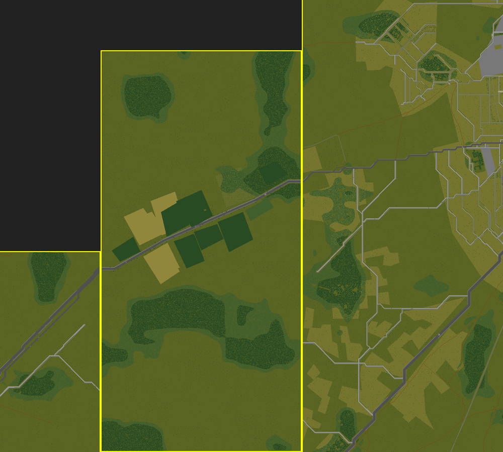

# Provincia de Ciudad Real para Project Zomboid

Un mapa jugable de **17 pueblos reales de la provincia de Ciudad Real** para Project Zomboid (Build 42). Cada pueblo está a escala real, con sus calles de OpenStreetMap y sus edificios del Catastro, y los pueblos están unidos por carreteras que siguen el trazado de las reales.


*Los 41 mapas que forman la beta: 17 pueblos (con borde amarillo) y 24 carreteras de enlace.*

## Qué hay en el mapa

- **Pueblos a escala real (1 tile = 2 m):** Ciudad Real con Miguelturra, Puertollano, Almagro, Bolaños de Calatrava, Daimiel, Malagón, Argamasilla de Calatrava, Piedrabuena, Poblete, Alcolea de Calatrava, Villamayor de Calatrava, Corral de Calatrava, Cañada de Calatrava, Caracuel de Calatrava, Villanueva de los Infantes, Villahermosa y Horcajo de los Montes. Son 461 celdas de 300 × 300 tiles.
- **Edificios del Catastro:** cada edificio tiene la huella oficial, su número real de plantas y su uso (vivienda, bloque, nave, comercio, edificio público). En Ciudad Real se pasa de unas 2.900 huellas en OpenStreetMap a unas 15.700.
- **Carreteras entre pueblos:** siguen la forma de la carretera real (N-420, N-430, N-401, A-43, CM-412, CM-4106…), con las distancias acortadas a menos de la mitad. De Ciudad Real a Almagro hay unos 9 km en el juego, frente a 24 km reales. Llevan campos, bosques, setos y casas de campo a los lados.
- **Cruces:** algunos pueblos se enganchan a mitad de otra carretera, como Cañada con la de Ciudad Real–Almagro.

| Antes / después del Catastro (casco de Ciudad Real) | Junta entre Poblete, el enlace y Ciudad Real |
|---|---|
|  |  |

## Cómo funciona

Los pueblos los genera [KnoxMap](https://github.com/spytheeuclidean-a11y/knoxmap), una herramienta de la comunidad que convierte datos de OpenStreetMap en mapas de Project Zomboid: calles, edificios con habitaciones y muebles, zombis según la población… Este proyecto es el pipeline que hay alrededor: datos españoles, colocación de los pueblos en el mundo y las carreteras que los unen.

```
 BBBike (OSM .pbf) ──┐
                     ├─ catastro_merge.py ─► .pbf con edificios del Catastro
 Catastro INSPIRE ───┘        │
 (descargar_catastro.py)      │
                              ▼
 roads.py ─► carreteras reales entre pueblos (grafo de OSM, caminos más cortos)
                              │
 layout.py / layout_add.py ─► plano: celda de cada pueblo en el mundo del juego
                              │
 provincia.py ─► con KnoxMap: genera los pueblos, los coloca y construye los enlaces
                              │
 compilar.py ─► compila e instala los 41 mapas como mods
                              │
 tools/check_*.py ─► comprueba solapes y que cada carretera encaje en su junta
```

### Las partes que no son triviales

- **Edificios del Catastro en OSM** (`catastro_merge.py`). Lee el GML INSPIRE (EPSG:25830), toma las plantas sobre rasante de las partes de cada edificio, traduce el uso a etiquetas `building=*` y sustituye los edificios de OSM que se solapan. El resultado es un `.pbf` normal que KnoxMap lee sin saber que viene del Catastro.
- **Colocación** (`layout.py`). Los pueblos no se pueden acercar más de lo que miden, así que se escalan las posiciones reales de forma uniforme y, si dos chocan, el segundo se aparta en la dirección real entre ellos. Así se conserva la forma de la provincia. Todos van con el norte arriba (sin el giro que KnoxMap aplica para alinear calles), para que las carreteras salgan de cada pueblo en su dirección real.
- **Juntas exactas** (`provincia.py`, `snap_link`). KnoxMap endereza las calles de cada pueblo y las desplaza cerca de los bordes, así que un enlace trazado sobre la carretera real llega desviado entre 150 y 250 tiles. Por eso cada enlace se engancha a las carreteras que el pueblo generado tiene de verdad en sus bordes, leídas de su `road_hierarchy.bmp`. Se eligen las dos salidas a la vez: grandes, de clase parecida (que una autovía no acabe en un callejón), cerca de la salida real y con el enlace más compacto. El desplazamiento de cada extremo se reparte a lo largo de la carretera para conservar su forma.
- **Dos mapas no pueden compartir celda.** Cada enlace es un mapa rectangular aparte. Si la recta no cabe sin pisar otro mapa, la carretera se busca con A* por las celdas libres (penalizando los giros) y se construye en tramos rectos, cada uno su propio mapa. Los enlaces muy largos se hacen siempre así: en un solo rectángulo serían cientos de celdas de campo vacío.
- **Cruces.** Para enganchar un pueblo a mitad de un enlace, se rehace el enlace con un ramal que sale de su carretera hasta el borde que mira al pueblo, y después se construye la carretera nueva hasta ese ramal.
- **Mapa de papel.** KnoxMap dibuja el mapa del juego con la descarga de OSM, y un enlace no la tiene; sin más, solo saldrían sus casas. Al construir cada enlace se le pasa su propio dibujo, así que la carretera sale en el mapa de papel en el mismo sitio que en el suelo.

## Reproducirlo

Hace falta Windows con Project Zomboid (Build 42) y KnoxMap instalado. Su `Setup.bat` saca los tiles de tu propia copia del juego. Los scripts usan el Python de KnoxMap y se lanzan desde su carpeta.

1. **Datos de OpenStreetMap:** un recorte en formato PBF de [extract.bbbike.org](https://extract.bbbike.org) que cubra los pueblos.
2. **Catastro:**
   ```
   python scripts/descargar_catastro.py datos/catastro 13900 13056 13071 ...
   python scripts/catastro_merge.py recorte.osm.pbf provincia.osm.pbf datos/catastro/*/
   ```
   `python scripts/descargar_catastro.py --lista 13` muestra los códigos de cada municipio.
3. **Plano** (opcional; `data/layout.json` es el de esta beta):
   ```
   python scripts/roads.py provincia.osm.pbf enlaces.json
   python scripts/layout.py <KnoxMap> enlaces.json salida 0.45
   python scripts/layout_add.py <KnoxMap> layout.json enlaces.json layout_nuevo.json Pueblo1,Pueblo2
   ```
4. **Generar**, desde la carpeta de KnoxMap y con su `output` vacío:
   ```
   .venv\Scripts\python.exe <repo>\scripts\provincia.py . provincia.osm.pbf <repo>\data\layout.json ^
       --pueblos todos --enlaces todos ^
       --cruces "CanadaDeCalatrava>CiudadReal-Almagro,Malagon>Piedrabuena-Alcolea"
   ```
5. **Compilar e instalar:** `.venv\Scripts\python.exe <repo>\scripts\compilar.py . <repo>\data\layout.json`
6. **Comprobar:** `python tools/check_bordes.py <KnoxMap>\output`
7. **Empaquetar para otros jugadores:** `pack\EMPAQUETAR.bat` crea un zip con los mods instalados, el [manual de instalación](pack/contenido/LEEME%20-%20Manual%20de%20instalacion.txt) y un instalador que los copia y activa sin tocar los demás mods del jugador.

Los pueblos y sus cajas están en `scripts/build_cr.py` (`PUEBLOS`).

## Limitaciones conocidas

- Los interiores son los que inventa KnoxMap, y en los cascos antiguos las manzanas no quedan cerradas del todo.
- El campo de los enlaces es genérico, no el terreno real. Fuera de pueblos y carreteras no hay suelo.
- Horcajo de los Montes está desplazado de su sitio para no caer encima del condado de Knox original.
- Una conexión no cabe (Poblete–Cañada directa); a esos pueblos se llega por otro lado.
- No está probado en multijugador.

## Créditos y licencias

- Código de este repositorio: licencia MIT (ver `LICENSE`).
- Datos de mapa: © colaboradores de OpenStreetMap, [ODbL](https://www.openstreetmap.org/copyright).
- Edificios: © Dirección General del Catastro, datos INSPIRE.
- [KnoxMap](https://github.com/spytheeuclidean-a11y/knoxmap) (MIT) genera los mapas; no se incluye aquí.
- Project Zomboid es de The Indie Stone. Este proyecto no está relacionado con ellos.
